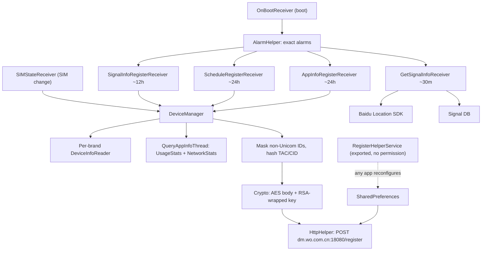
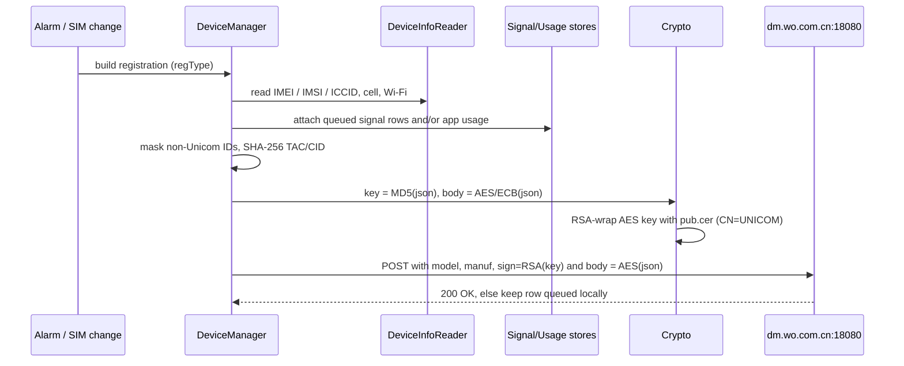

# 2. Architecture & components

[← Overview](01-Overview.md) · Next: [Data collection →](03-Data-Collection.md)

## Process & privilege model

The app installs to `/system/priv-app` and declares `sharedUserId`
`com.mobiletools.systemhelper.uid`. It runs under **its own app UID** (10504 on the sampled
device), not the system UID, but being on the privileged system partition lets it hold the
privileged permissions in [Overview](01-Overview.md#permissions-it-holds). It has no
launcher entry and no settings UI. *(UID observed on device.)*

## Components (from `resources/AndroidManifest.xml`)

**Broadcast receivers** — `sources/com/mobiletools/systemhelper/control/`

| Receiver | Trigger | Role |
|---|---|---|
| `OnBootReceiver` | `BOOT_COMPLETED`, `QUICKBOOT_POWERON` (priority max), **exported** | Starts the scheduler on boot |
| `GetSignalInfoReceiver` | alarm, ~30 min | Fix location (Baidu) + snapshot signal; store row |
| `SignalInfoRegisterReceiver` | alarm, ~12 h | Upload the batch of stored signal rows |
| `ScheduleRegisterReceiver` | alarm, ~24 h | Upload a full device registration |
| `AppInfoRegisterReceiver` | alarm, ~24 h | Upload the per-app usage report |
| `SIMStateReceiver` | `SIM_STATE_CHANGED`, **exported** | On SIM change, send a registration (type `"T"`) |
| `ConnectStateReceiver` | `CONNECTIVITY_CHANGE`, **exported** | React to connectivity changes |

**Services** — `sources/com/mobiletools/systemhelper/service/`

| Service | Exported | Role |
|---|---|---|
| `RegisterHelperService` | **yes, no permission** | Binder (`IRegisterHelperService`) to reconfigure the module — see [Security weaknesses](06-Security-Weaknesses.md) |
| `RegisterIntentService` | no | Background runner |
| `RegisterJobService` | `BIND_JOB_SERVICE` | Scheduled job runner |

**Activity** — `TestActivity` (`sources/com/mobiletools/systemhelper/Activity/TestActivity.java`),
**exported**, displays the device registration payload on screen.

**Application** — `DMApplication`
(`sources/com/mobiletools/systemhelper/control/DMApplication.java`).

## Core logic (obfuscated packages)

Recovered names; see [Class reference](08-Class-Reference.md).

- **`f1/o.java` — `DeviceManager`**: the orchestrator. Picks a per-brand reader, builds the
  registration bean, applies masking, and dispatches the right upload thread by "regType".
- **`f1/a.java` … `f1/n.java` — `DeviceInfoReader*`**: per-brand readers of identifiers and
  cell info (Xiaomi = `f1/m.java`).
- **`e1/` — worker threads + beans**: `DeviceInfo` (`e1/b.java`), `SignalInfo`
  collector `GetSignalStrengthInfo` (`e1/d.java`), `DMTelephonyCallback` (`e1/a.java`),
  `QueryAppInfoThread` (`e1/f.java`), `RegisterThread` (`e1/g.java`), `HistoryPostThread`
  (`e1/e.java`), `GetIPAddressThread` (`e1/c.java`).
- **`g1/` — utilities**: `AlarmHelper` (`g1/a.java`), `HttpHelper` (`g1/f.java`), crypto
  (`g1/c.java`), `RSAHelper` (`g1/j.java`), `RegisterUtils` (`g1/l.java`), `SignalInfo`
  bean (`g1/n.java`), `AppInfo` bean (`g1/b.java`), `SignalDatabaseHelper` (`g1/m.java`),
  `HistoryDatabaseHelper` (`g1/e.java`), and static config `GlobalSetting` (`g1/d.java`).

## Data stores

| Store | Class | Holds |
|---|---|---|
| Signal DB (SQLite) | `SignalDatabaseHelper` `g1/m.java` | Location+signal snapshots, uploaded then cleared |
| History DB (SQLite) | `HistoryDatabaseHelper` `g1/e.java` | Registration records queued when upload is skipped |
| SharedPreferences | `com_mobiletools_systemhelper_preference` via `RegisterUtils` `g1/l.java` | `serverAddress`, all intervals, `preference_enable_log` |

## Control flow

## Upload sequence (registration)

Next: [What data is collected →](03-Data-Collection.md)
