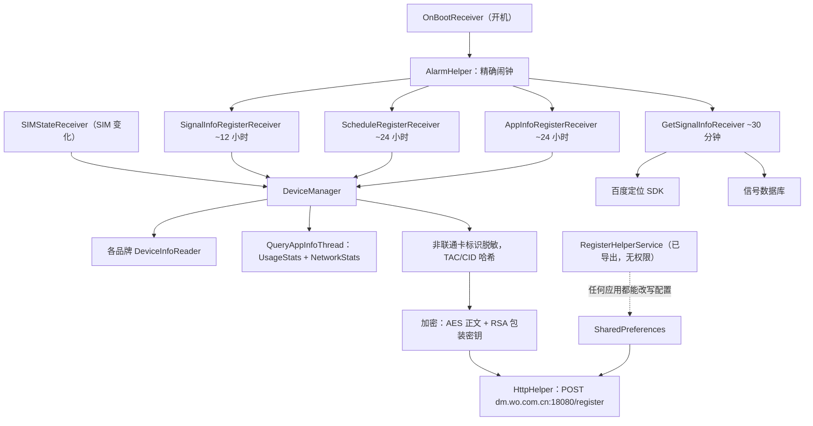
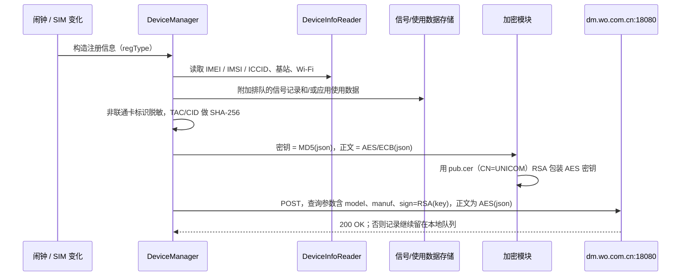

# 2. 架构与组件

语言：[English](../02-Architecture.md) · **中文**

[← 概览](01-Overview.md) · 下一页：[数据采集 →](03-Data-Collection.md)

## 进程与权限模型

应用安装在 `/system/priv-app`，并声明 `sharedUserId` 为 `com.mobiletools.systemhelper.uid`。
它以**自己的应用 UID** 运行（采样设备上为 10504），而不是系统 UID；但因为位于特权系统分区，
它可以持有[概览](01-Overview.md)中列出的特权权限。它没有桌面入口，也没有设置界面。
*（UID 为设备上观察到的值。）*

## 组件（来自 `resources/AndroidManifest.xml`）

**广播接收器**——`sources/com/mobiletools/systemhelper/control/`

| 接收器 | 触发条件 | 作用 |
|---|---|---|
| `OnBootReceiver` | `BOOT_COMPLETED`、`QUICKBOOT_POWERON`（最高优先级），**已导出** | 开机后启动调度器 |
| `GetSignalInfoReceiver` | 定时闹钟，约 30 分钟 | 通过百度定位并采集信号快照；写入数据库 |
| `SignalInfoRegisterReceiver` | 定时闹钟，约 12 小时 | 上传已保存的一批信号记录 |
| `ScheduleRegisterReceiver` | 定时闹钟，约 24 小时 | 上传完整的设备注册信息 |
| `AppInfoRegisterReceiver` | 定时闹钟，约 24 小时 | 上传逐应用使用报告 |
| `SIMStateReceiver` | `SIM_STATE_CHANGED`，**已导出** | SIM 卡变化时发送注册信息（类型 `"T"`） |
| `ConnectStateReceiver` | `CONNECTIVITY_CHANGE`，**已导出** | 响应网络连接变化 |

**服务**——`sources/com/mobiletools/systemhelper/service/`

| 服务 | 已导出 | 作用 |
|---|---|---|
| `RegisterHelperService` | **是，且无权限保护** | 通过 Binder（`IRegisterHelperService`）重新配置模块，见[安全缺陷](06-Security-Weaknesses.md) |
| `RegisterIntentService` | 否 | 后台任务执行器 |
| `RegisterJobService` | `BIND_JOB_SERVICE` | 定时 Job 执行器 |

**Activity**——`TestActivity`（`sources/com/mobiletools/systemhelper/Activity/TestActivity.java`），
**已导出**，会把设备注册信息直接显示在屏幕上。

**Application**——`DMApplication`
（`sources/com/mobiletools/systemhelper/control/DMApplication.java`）。

## 核心逻辑（混淆后的包）

以下使用还原名；完整对照见[类参考](08-Class-Reference.md)。

- **`f1/o.java`——`DeviceManager`**：编排器。选择各品牌的读取器、构造注册对象、执行脱敏，
  再按 `regType` 分派到对应上传线程。
- **`f1/a.java` … `f1/n.java`——`DeviceInfoReader*`**：各品牌读取标识符和基站信息的实现
  （小米为 `f1/m.java`）。
- **`e1/`——工作线程与数据对象**：`DeviceInfo`（`e1/b.java`）、`SignalInfo` 采集器
  `GetSignalStrengthInfo`（`e1/d.java`）、`DMTelephonyCallback`（`e1/a.java`）、
  `QueryAppInfoThread`（`e1/f.java`）、`RegisterThread`（`e1/g.java`）、
  `HistoryPostThread`（`e1/e.java`）、`GetIPAddressThread`（`e1/c.java`）。
- **`g1/`——工具类**：`AlarmHelper`（`g1/a.java`）、`HttpHelper`（`g1/f.java`）、
  加密（`g1/c.java`）、`RSAHelper`（`g1/j.java`）、`RegisterUtils`（`g1/l.java`）、
  `SignalInfo` 对象（`g1/n.java`）、`AppInfo` 对象（`g1/b.java`）、
  `SignalDatabaseHelper`（`g1/m.java`）、`HistoryDatabaseHelper`（`g1/e.java`），以及静态配置
  `GlobalSetting`（`g1/d.java`）。

## 数据存储

| 存储 | 类 | 内容 |
|---|---|---|
| 信号数据库（SQLite） | `SignalDatabaseHelper` `g1/m.java` | 位置与信号快照；上传后清除 |
| 历史数据库（SQLite） | `HistoryDatabaseHelper` `g1/e.java` | 当上传条件不满足时排队的注册记录 |
| SharedPreferences | 通过 `RegisterUtils` `g1/l.java` 访问 `com_mobiletools_systemhelper_preference` | `serverAddress`、全部采集间隔、`preference_enable_log` |

## 控制流

## 上传流程（设备注册）

下一页：[采集了哪些数据 →](03-Data-Collection.md)
